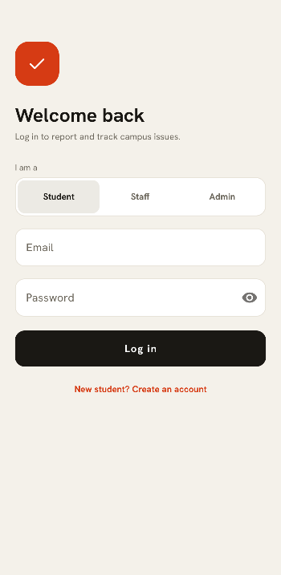
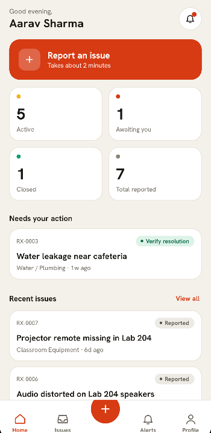
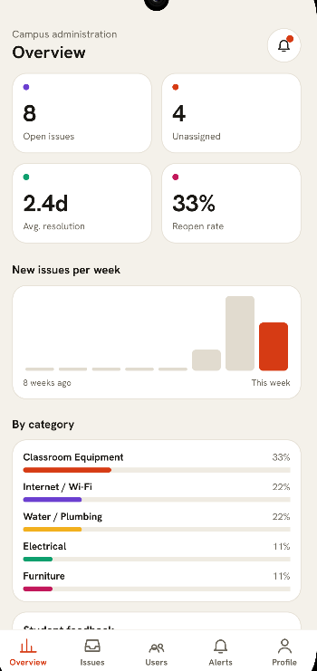
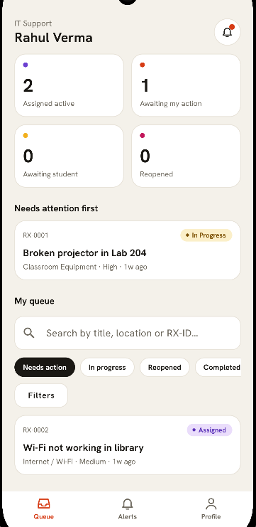

# ResolveX | Campus Issue Management System

**A Role-Based Android Application for Campus Issue Reporting, Tracking, and Resolution Management**

ResolveX is an Android application designed to simplify campus issue management through a structured digital platform. It connects students, staff members, and administrators, enabling issues to be reported, assigned, tracked, and reviewed through a centralized workflow.

**The problem:** Campus complaints such as broken equipment, Wi-Fi failures, or plumbing faults are often reported informally, so nobody can see who is handling them or whether they were actually fixed. ResolveX replaces that with a single tracked workflow, from report to verified resolution, with accountability at every step and analytics for administrators.

## Application Preview

<p align="center">
  <br />
  <em>Login screen</em>
</p>

<p align="center">
  <br />
  <em>Student dashboard</em>
</p>

<p align="center">
  <br />
  <em>Admin dashboard</em>
</p>

<p align="center">
  <br />
  <em>Staff dashboard</em>
</p>

## Key Features

### Student Module
- **Issue Reporting:** Submit issues with a description, a category (Classroom Equipment, Internet / Wi-Fi, Water / Plumbing, Furniture, Electrical, Cleanliness / Sanitation, Other), a Low / Medium / High priority, a campus location, and supporting images.
- **Issue Tracking:** Follow each issue (ID format `RX-0001`) through its status timeline: Reported, Assigned, In Progress, Resolution Submitted, Verified, Reopened, Closed.
- **Resolution Verification:** Accept a resolution to verify it, or reopen the issue if the problem persists.
- **Feedback System:** Provide feedback on issue resolution.
- **Notifications:** Get notified when an issue changes status or needs your action.
- **Issue History:** Access information about reported issues and their progress.

### Staff Module
- **Assigned Issues:** View issues assigned for resolution.
- **Status Updates:** Update issue statuses as work progresses.
- **Resolution Management:** Maintain progress and resolution information for assigned issues.

### Admin Module
- **Centralized Issue Management:** View and manage campus issue records.
- **Staff Assignment:** Assign issues to appropriate staff members.
- **User Management:** Manage application users and staff records.
- **Analytics Dashboard:** Monitor issue statistics and resolution trends.
- **Category-Wise Analysis:** Review issues across different categories.
- **Recurring Issue Tracking:** Inspect recurring campus problems.
- **Search and Filtering:** Narrow issue lists by status and category.
- **CSV Export:** Export issue records for reporting and further analysis.
- **Feedback Management:** Review feedback and monitor resolution progress.

## Technology Stack

| Technology | Purpose |
|---|---|
| Java | Android application logic |
| XML | User interface layouts and resources |
| Android SDK | Native Android development |
| SQLite | Local relational database |
| AndroidX AppCompat | Activity and compatibility support |
| Material Components | UI components and styling |
| RecyclerView | Displaying structured lists |
| SharedPreferences | Local session information |
| PBKDF2 | Password hashing |
| Android FileProvider | Controlled file sharing |
| Gradle | Build configuration and dependency management |

## Application Workflow

```text
Student Reports an Issue
          |
          v
Issue Stored in Database
          |
          v
Admin Reviews and Assigns
          |
          v
Staff Handles the Issue
          |
          v
Status and Resolution Updated
          |
          v
Student Verifies Resolution
          |
          v
Feedback and Admin Monitoring
```

Valid status transitions are enforced in the app: `Submitted → Assigned → In Progress → Resolved → Verified → Closed`, with `Resolved → Reopened → In Progress` when the student rejects a fix.

## Project Architecture

ResolveX follows a modular Android application structure that separates screen-level logic, database operations, data models, adapters, and reusable utility classes.

```text
app/
├── manifests/
│   └── AndroidManifest.xml
├── kotlin+java/
│   └── com.example.resolvex_prototype/
│       ├── activities/
│       ├── adapters/
│       ├── database/
│       ├── models/
│       ├── receivers/
│       └── utils/
├── res/
│   ├── color/
│   ├── drawable/
│   ├── font/
│   ├── layout/
│   ├── mipmap/
│   ├── values/
│   └── xml/
└── keepRules/
    └── rules.keep
```

### Core Components

| Component | Responsibility |
|---|---|
| `activities/` | Application screens, user interactions, and role-specific workflows |
| `adapters/` | Binds data to RecyclerView lists |
| `database/` | Manages SQLite database operations |
| `models/` | Represents application data entities |
| `receivers/` | Handles broadcast events, including issue status changes |
| `utils/` | Contains reusable session, security, filtering, export, and supporting logic |
| `res/layout/` | XML layouts for application screens |
| `res/drawable/` | Icons, drawable resources, and UI backgrounds |
| `res/color/` | Color resources |
| `res/font/` | Custom font resources |
| `res/mipmap/` | Application launcher icons |
| `res/values/` | Strings, themes, colors, dimensions, and other resource values |
| `res/xml/` | XML configuration files, including FileProvider paths |
| `AndroidManifest.xml` | Declares application components, permissions, and provider configuration |
| `keepRules/rules.keep` | Contains rules for preserving specified classes or members during supported build optimizations |

Android Studio groups Java and Kotlin source folders under `kotlin+java`. This project uses Java for its main application logic.

## Getting Started

### Prerequisites

- Android Studio compatible with the project's Gradle configuration.
- A compatible JDK configured in Android Studio.
- Android SDK Platform 37.
- An Android device or emulator running Android 7.0 (API 24) or later.

### Installation

**1. Clone the repository**

```bash
git clone https://github.com/Ayush2496/ResolveX.git
```

**2. Open the project**

Open the cloned repository in Android Studio.

**3. Sync Gradle**

Allow Android Studio to download dependencies and complete the Gradle synchronization.

**4. Run the application**

Connect an Android device with USB debugging enabled or launch an emulator. Select the `app` run configuration and click **Run**.

### Demo Accounts

A fresh install is seeded with sample users and issues so every role can be tried immediately:

| Role | Email | Password |
|---|---|---|
| Student | `student@nmims.in` | `student123` |
| Student | `student2@nmims.in` | `student123` |
| Staff (IT Support) | `staff@nmims.in` | `staff123` |
| Staff (Electrical) | `elec@nmims.in` | `staff123` |
| Staff (General Maintenance) | `maint@nmims.in` | `staff123` |
| Admin | `admin@nmims.in` | `admin123` |

These are demo credentials for local testing only.

### Build the APK

On Windows:

```powershell
.\gradlew.bat assembleDebug
```

On macOS or Linux:

```bash
./gradlew assembleDebug
```

The generated debug APK is normally located at:

```text
app/build/outputs/apk/debug/app-debug.apk
```

## Data Storage and Security

- **Database:** SQLite stores all data locally; schema creation and upgrades live in `DatabaseHelper.java`.
- **Passwords:** Hashed with PBKDF2 using an individual salt per user.
- **Sessions:** Local session information is kept in SharedPreferences.
- **File Sharing:** Android FileProvider gives controlled URI access to exported CSV files.

**Storage limitation:** Data is stored on the device only. Sharing records between multiple devices would require a backend or synchronization service.

## Future Scope

- Cloud-based storage and synchronization across devices.
- Expanded automated testing of application workflows.
- Additional reporting and resolution performance metrics.
- Further improvements to accessibility and usability.

## License

No license has been specified for this repository.

